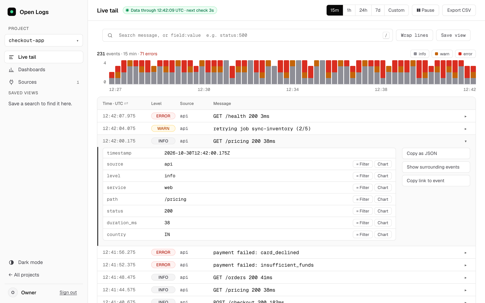
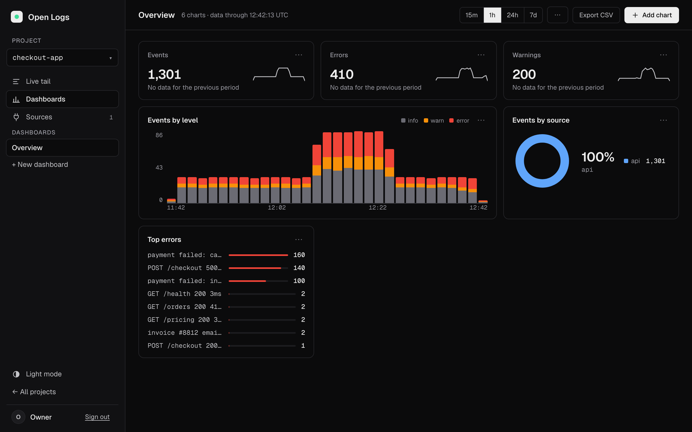
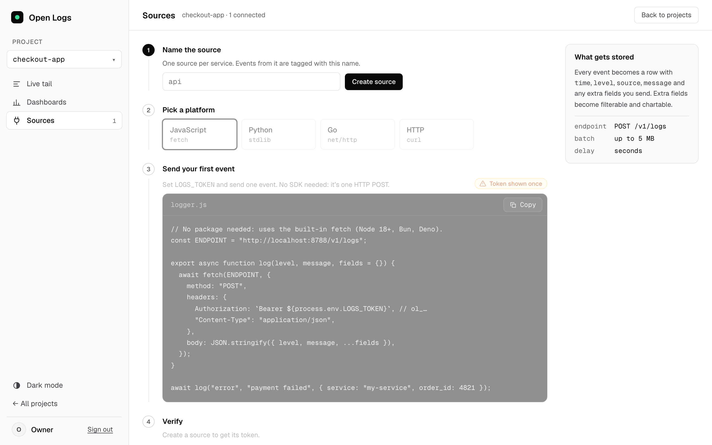

# Open Logs

**Open-source, self-hosted log management for your own Cloudflare account.**
Live tail, search, filters, charts and dashboards for your team. It runs on Cloudflare Workers, keeps app data
in D1 and stores logs in Cloudflare Basin. Your logs never leave your account.



| Dashboards | Connect a source |
|---|---|
|  |  |

## What it is

Cloudflare Basin (Pipelines + Catalog + SQL) is cheap, serverless log storage. It has no product on top:
no per-app ingest auth, no log viewer, no charts without SQL, no team login. Open Logs is that layer.

- Your apps send logs over HTTP to `POST /v1/logs`, each with its own source token.
- The Worker writes them to a Basin Pipelines stream. Basin turns them into an Iceberg table in R2.
- The dashboard searches and charts them with Basin SQL.
- D1 holds only app data: users, sessions, projects, sources, tokens, views, dashboards, charts, settings.

Logs become searchable about 1 to 3 minutes after they arrive. That is how often Basin writes new files.

## Requirements

- A Cloudflare account on the **Workers Paid** plan ($5/month). Basin needs it.
- Node.js 20 or newer, and `git`.

Open Logs runs only on Cloudflare. There is no local mode: Basin has no local version.

## Install

```bash
git clone <repository URL> open-logs
cd open-logs
npm run setup
```

Setup asks for one Cloudflare API token. Create it before you start:

1. Cloudflare dashboard → **R2** → **Manage API tokens** → **Create Account API token**.
2. Permissions: **Admin Read & Write**. This includes Basin SQL Read.
3. Create it and copy the token value.

Open Logs uses this token for the Basin sink (it writes the Iceberg table) and stores it as the
`BASIN_SQL_TOKEN` Worker secret (it runs searches). Setup does not write it to disk.

What `npm run setup` does:

1. Installs packages and runs `wrangler login` if you are not signed in.
2. Picks your Cloudflare account (it asks if you have more than one).
3. Asks for the API token and your email. You sign in with that email.
4. Creates, in your account: an R2 bucket, a Basin Catalog on it, a Pipelines stream, an Iceberg sink
   (new files every 60 seconds), a pipeline from the stream to the sink, and a D1 database.
5. Writes the install's config to `.open-logs/<name>.jsonc` and its resource ids to `.open-logs/<name>.json`.
   This folder is gitignored. Keep it: update, rollback and uninstall read it.
6. Applies the D1 migrations, builds the dashboard and deploys the Worker.
7. Sets two secrets: `ADMIN_PASSWORD` (random, printed once) and `BASIN_SQL_TOKEN`.
8. Checks that the app is up (a few seconds). It does not wait for Basin: your first log shows up 1 to 3
   minutes after you send it.

At the end it prints your `workers.dev` URL, your email and the password. Save the password: it is not shown
again. You can change it in Settings. Sign in, then invite your team from the Team page.

Options:

- Setup asks for the install name (press Enter for `open-logs`); `npm run setup -- --name my-logs` skips the
  question. Each name is a separate install, and every resource it creates gets that name.
- `OPEN_LOGS_TOKEN`, `OPEN_LOGS_EMAIL` and `OPEN_LOGS_PASSWORD` make setup non-interactive.

## Security

**Open Logs is self-hosted. Put its URL behind Cloudflare Access, free for up to 50 users, so only your
team can reach it.**

1. Cloudflare dashboard → **Zero Trust** → **Access** → **Applications** → **Add an application**.
2. Choose **Self-hosted**. Set the domain to your Worker's `workers.dev` hostname
   (for example `open-logs.your-subdomain.workers.dev`).
3. Add a policy with action **Allow** that includes your team's emails (or your email domain).
4. **Important:** add a second self-hosted application for the same hostname with the path `/v1/logs`,
   and give it a policy with action **Bypass** for **Everyone**. Your apps send logs to `/v1/logs` with their
   source token. They cannot pass a sign-in page, so without this bypass ingest stops working.

The app's own sign-in stays on as a second layer. Access keeps strangers away from the sign-in page; the
app still checks every user's password and role.

To report a vulnerability, see [SECURITY.md](SECURITY.md).

## Send logs

Create a project, add a source, and copy its token (shown once). No SDK: it's one HTTP POST of a JSON
object or an array of them. Every key besides `level`, `message`, `ts` becomes a filterable field.

**curl**
```bash
curl -X POST https://YOUR-WORKER.workers.dev/v1/logs \
  -H "Authorization: Bearer $LOGS_TOKEN" \
  -H "Content-Type: application/json" \
  -d '{"level":"error","message":"payment failed","order_id":4821}'
```

**JavaScript** (Node 18+, Bun, Deno)
```js
await fetch("https://YOUR-WORKER.workers.dev/v1/logs", {
  method: "POST",
  headers: { Authorization: `Bearer ${process.env.LOGS_TOKEN}`, "Content-Type": "application/json" },
  body: JSON.stringify({ level: "error", message: "payment failed", order_id: 4821 }),
});
```

**Python** (standard library)
```python
import json, os, urllib.request
req = urllib.request.Request("https://YOUR-WORKER.workers.dev/v1/logs", method="POST",
    data=json.dumps({"level": "error", "message": "payment failed", "order_id": 4821}).encode(),
    headers={"Authorization": "Bearer " + os.environ["LOGS_TOKEN"], "Content-Type": "application/json"})
urllib.request.urlopen(req, timeout=5)
```

**Go**
```go
body, _ := json.Marshal(map[string]any{"level": "error", "message": "payment failed", "order_id": 4821})
req, _ := http.NewRequest("POST", "https://YOUR-WORKER.workers.dev/v1/logs", bytes.NewReader(body))
req.Header.Set("Authorization", "Bearer "+os.Getenv("LOGS_TOKEN"))
req.Header.Set("Content-Type", "application/json")
http.DefaultClient.Do(req)
```

The connect page generates these with your URL filled in.

## Use it

- **Live tail**: type text or `field:value` (`level:error`, `status:>=500`, `source:api,worker`, `code:*`),
  pick 15m / 1h / 24h / 7d / custom, click a histogram bar to zoom, toggle levels in the legend, `j`/`k` to move,
  `Enter` to expand, `/` to search. Expand an event to filter or chart any field.
- **Dashboards**: count, count over time, average or p95 of any field as bar, pie, line or number. Pin, edit,
  duplicate, remove, export CSV.
- **Sources** can be renamed. Their history stays with them, because every log records the source's
  permanent id. A new source that reuses a deleted source's name starts empty.
- **Saved views** in the sidebar, **team** invites with owner / admin / member roles, **settings** for the
  team name and your password, light and dark themes.

## Limits

| | |
|---|---|
| Request | 5 MB, 10,000 events |
| Event | 256 KB |
| Ingest rate | 1,200 requests/min per token (batch your events) |
| Freshness | logs are searchable about 1 to 3 minutes after they arrive |
| Query range | 7 days, 500 rows per page; free-text search over more than 24h needs a field filter |
| Timestamps | client `ts` within ±24h of server time is kept, otherwise server time is used |

Known Basin behaviour: p95 is approximate (`approx_percentile_cont`), heavy searches can time out and show
"query too large", and deleting a project does not delete its log files in R2 (Basin SQL is read-only).
Details in [docs/PLAN.md](docs/PLAN.md).

Full contract: [docs/API.md](docs/API.md). Design: [docs/ARCHITECTURE.md](docs/ARCHITECTURE.md).

## Update, roll back, uninstall

Run these from your clone. Each one asks which install (press Enter for `open-logs`); `-- --name <name>` skips
the question.

```bash
npm run update      # move to the newest release
npm run rollback    # put the previous Worker version back
npm run uninstall   # remove everything setup created
```

- **Update** checks out the newest release tag (or `-- --to vX.Y.Z`), installs packages, regenerates the
  config, applies only the new D1 migrations, builds and deploys, then checks that the app is up.
- **Roll back** uses `wrangler rollback` to put the previous Worker version live. It does not change the
  database. If an update damaged app data, it prints the D1 Time Travel command that restores the database
  to a minute before the update. Logs in Basin are never changed by an update.
- **Uninstall** asks you to type the install name. Then it removes the Worker and its secrets, the pipeline,
  sink and stream, the Basin Catalog, every file in the bucket (using your API token), the bucket and the D1
  database. Delete the API token yourself afterwards (R2 → Manage API tokens). Scripts cannot delete
  API tokens.

## Costs

- Workers Paid plan: $5/month.
- Basin usage in your account: Pipelines ingest, R2 storage for the log files, and Basin SQL queries.
  Each search or chart is one or more Basin SQL queries. A dashboard load runs about 25 queries.
  See Cloudflare's pricing pages for current rates.

D1 holds only app data, so it stays small.

## Development

Open Logs only runs on Cloudflare, so there is no local server. `npm run dev` only prints a reminder.

Branches:

- `main` is released code. Each release is tagged `vX.Y.Z`.
- `develop` is where finished work is merged.
- Work happens on `feature/*` branches from `develop`. Each branch is deployed to the test install with
  `npm run deploy:staging` and tested there against real Basin, then merged into `develop`.

Staging is an ordinary install, kept in `.open-logs/` like any other. Create it once with a name of your choice,
e.g. `npm run setup -- --name open-logs-staging`. The staging commands ask which install, or take `-- --name`.

```bash
npm run deploy:staging   # deploy the current branch to staging (new D1 migrations, build, deploy)
npm run staging:reset    # from develop only: wipe staging's D1 and redeploy develop
npm run lint
```

There are no automated tests or CI yet; they will be added later. Changes are checked on staging.

Worker: Hono on Cloudflare Workers (`src/`). UI: React + Vite (`app/`), built to `dist/` and served by the Worker.
Plain JavaScript with JSDoc. See [CLAUDE.md](CLAUDE.md) and [docs/PLAN.md](docs/PLAN.md).

## License

MIT
