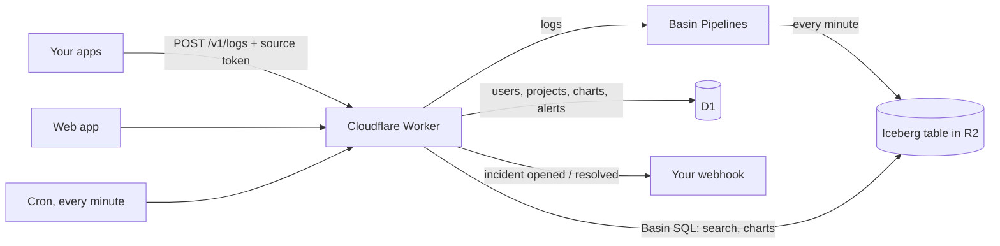

# Open Logs

Keep your app's logs in your own Cloudflare account, affordably and for as long as you want,
with live tail, search, dashboards and alerts on top.

## How it works



- **Worker** (Hono): checks each app's token, writes logs to Basin, serves the web app and its API.
- **Basin** stores the logs as an Iceberg table in R2 and answers searches with Basin SQL. Affordable to keep
  for a long time; logs become searchable 1.5–3.5 minutes after they're sent.
- **D1** holds only app data: users, projects, sources, dashboards, alerts.
- **Alerts**: every minute a check runs each alert's chart query and sends a webhook when an incident opens
  or resolves.

## Requirements

- A Cloudflare account on the **Workers Paid** plan ($5/month). Basin needs it.
- Node.js 20 or newer, and `git`.

Open Logs runs only on Cloudflare. There is no local mode: Basin has no local version.

## Install

```bash
git clone https://github.com/Adithya188288/open-logs.git open-logs
cd open-logs
npm run setup
```

Setup asks for one Cloudflare API token. Create it before you start:

1. Cloudflare dashboard → **R2** → **Manage API tokens** → **Create Account API token**.
2. Permissions: **Admin Read & Write**. This includes Basin SQL Read.
3. Create it and copy the token value.

Open Logs uses this token for the Basin sink (it writes the Iceberg table) and stores it as the
`BASIN_SQL_TOKEN` Worker secret (it runs searches). Setup does not write it to disk.

What `npm run setup` does:

1. Installs packages and runs `wrangler login` if you are not signed in.
2. Picks your Cloudflare account (it asks if you have more than one).
3. Asks for the API token and your email. You sign in with that email.
4. Creates, in your account: an R2 bucket, a Basin Catalog on it (with your token stored as its credential,
   for Cloudflare's table maintenance), a Pipelines stream, an Iceberg sink (new files every 60 seconds),
   a pipeline from the stream to the sink, and a D1 database.
5. Writes the install's config to `.open-logs/<name>.jsonc` and its resource ids to `.open-logs/<name>.json`.
   This folder is gitignored. Keep it: update, rollback and uninstall read it.
6. Applies the D1 migrations, builds the dashboard and deploys the Worker.
7. Sets two secrets: `ADMIN_PASSWORD` (random, printed once) and `BASIN_SQL_TOKEN`.
8. Checks that the app is up (a few seconds). It does not wait for Basin: your first log shows up 1 to 3
   minutes after you send it.

At the end it prints your `workers.dev` URL, your email and the password. Save the password: it is not shown
again. You can change it in Settings. Sign in, then invite your team from the Team page.

Options:

- Setup asks for the install name (press Enter for `open-logs`); `npm run setup my-logs` skips the
  question. Each name is a separate install, and every resource it creates gets that name.
- `OPEN_LOGS_TOKEN`, `OPEN_LOGS_EMAIL` and `OPEN_LOGS_PASSWORD` make setup non-interactive.

## Send logs (API)

Create a project, add a source, and copy its token (shown once). There is no SDK to install: sending logs is
one HTTP request.

```
POST https://YOUR-WORKER.workers.dev/v1/logs
Authorization: Bearer <source token>
Content-Type: application/json
```

**Body:** one log as a JSON object, or many logs as a JSON array (up to 10,000 logs or 5 MB per request).
Sending logs in batches is faster and uses fewer requests than sending them one by one.

| Key | Meaning |
|---|---|
| `message` (or `msg`) | The log line. |
| `level` (or `severity`) | `debug`, `info`, `warn`, `error` or `fatal`. Common names like `warning`, `err`, `critical` are understood. Default `info`. |
| `ts` (or `timestamp`) | When it happened: Unix milliseconds or seconds, or an ISO date. Default: when it arrives. |
| anything else | Kept as a field you can search and chart, e.g. `order_id`, `status`, `user.plan`. |

**Answers:**

| Status | Meaning |
|---|---|
| `202 { "accepted": 3 }` | Saved. Searchable 1.5–3.5 minutes later. |
| `400` | The body isn't a JSON object or array of objects, or the array is empty. |
| `401` | Missing or wrong token. |
| `413` | Over 10,000 logs or 5 MB per request, or one log over 256 KB. |
| `429` | Over 1,200 requests a minute for this source. Send fewer, bigger batches. |

**curl**
```bash
curl -X POST https://YOUR-WORKER.workers.dev/v1/logs \
  -H "Authorization: Bearer $LOGS_TOKEN" \
  -H "Content-Type: application/json" \
  -d '[{"level":"error","message":"payment failed","order_id":4821},
       {"level":"info","message":"order shipped","order_id":4822}]'
```

**JavaScript** (Node 18+, Bun, Deno)
```js
await fetch("https://YOUR-WORKER.workers.dev/v1/logs", {
  method: "POST",
  headers: { Authorization: `Bearer ${process.env.LOGS_TOKEN}`, "Content-Type": "application/json" },
  body: JSON.stringify([
    { level: "error", message: "payment failed", order_id: 4821 },
    { level: "info", message: "order shipped", order_id: 4822 },
  ]),
});
```

**Python** (standard library)
```python
import json, os, urllib.request

logs = [
    {"level": "error", "message": "payment failed", "order_id": 4821},
    {"level": "info", "message": "order shipped", "order_id": 4822},
]
req = urllib.request.Request("https://YOUR-WORKER.workers.dev/v1/logs", method="POST",
    data=json.dumps(logs).encode(),
    headers={"Authorization": "Bearer " + os.environ["LOGS_TOKEN"], "Content-Type": "application/json"})
urllib.request.urlopen(req, timeout=5)
```

**Go**
```go
logs := []map[string]any{
    {"level": "error", "message": "payment failed", "order_id": 4821},
    {"level": "info", "message": "order shipped", "order_id": 4822},
}
body, _ := json.Marshal(logs)
req, _ := http.NewRequest("POST", "https://YOUR-WORKER.workers.dev/v1/logs", bytes.NewReader(body))
req.Header.Set("Authorization", "Bearer "+os.Getenv("LOGS_TOKEN"))
req.Header.Set("Content-Type", "application/json")
http.DefaultClient.Do(req)
```

When you add a source, the app shows these snippets with your URL filled in.

## Use it

- **Live tail**: type text or `field:value` (`level:error`, `status:>=500`, `source:api,worker`, `code:*`),
  pick 15m / 1h / 24h / 7d / custom, click a histogram bar to zoom, toggle levels in the legend, `j`/`k` to move,
  `Enter` to expand, `/` to search. Expand an event to filter or chart any field.
- **Dashboards**: count, count over time, average or p95 of any field as bar, pie, line or number. Pin, edit,
  duplicate, remove, export CSV.
- **Sources** can be renamed. Their history stays with them, because every log records the source's
  permanent id. A new source that reuses a deleted source's name starts empty.
- **Alerts**: on any chart, add an alert (above a number or up by a %), a quiet time, and a webhook URL.
- **Saved views** in the sidebar, **team** invites with owner / admin / member roles, **settings** for the
  team name and your password, light and dark themes.

## Limits

**Sending logs**

- **5 MB per request.** One `POST /v1/logs` request can carry at most 5 MB of data. This is the most
  Cloudflare Basin accepts in one write.
- **10,000 logs per request.** One request can carry an array of up to 10,000 logs.
- **256 KB per log.** A single log (its message plus its fields) can be at most 256 KB. This keeps one huge
  log, like a pasted file, from slowing down search for everyone.
- **1,200 requests per minute per source.** Each source (each app's token) can send up to 1,200 requests a
  minute, about 20 a second. If it sends more, the extra requests get `429 Too Many Requests` and those logs
  are not saved. This protects your account if a token leaks or an app gets stuck in a loop. You rarely need
  more: send logs in batches (one request can carry thousands of logs) instead of one request per log.
- **Log times within 24 hours.** Your app can send its own time for each log (`ts`). If that time is within
  24 hours of when the log arrives, it's kept. If it's further off (for example, a server with a wrong clock
  says 2019), the arrival time is used instead, so the log still shows up where you'd look for it.

**Searching**

- **Logs appear 1.5 to 3.5 minutes after they're sent.** That's how often Basin writes new log files.
- **Up to 7 days at a time.** Live tail, search and charts let you pick 15 minutes, 1 hour, 24 hours or 7 days.
  7 days is the longest, so a single search never reads months of logs at once.
- **500 logs per page.** The log list shows 500 logs at a time; "Load older" shows the next 500.
- **Word search over more than 24 hours needs a filter.** Searching for a plain word (like `timeout`) reads
  the text of every log. Over more than 24 hours, add a filter as well, such as `level:error` or
  `source:api`, so the search reads fewer logs and stays fast.

**Good to know**

- p95 values on charts are close estimates, not exact.
- A very heavy search can time out. Narrow the time range or add a filter and try again.
- Deleting a project removes it from the app, but its old log files stay in your R2 bucket.

## Update, roll back, uninstall

Run these from your clone. Each one asks which install (press Enter for `open-logs`); `npm run update my-logs` skips
the question.

```bash
npm run update      # move to the newest release
npm run rollback    # put the previous Worker version back
npm run uninstall   # remove everything setup created
```

- **Update** checks out the newest release tag (or a given one: `npm run update my-logs v0.2.0`), installs packages, regenerates the
  config, applies only the new D1 migrations, builds and deploys, then checks that the app is up.
- **Roll back** uses `wrangler rollback` to put the previous Worker version live. It does not change the
  database. If an update damaged app data, it prints the D1 Time Travel command that restores the database
  to a minute before the update. Logs in Basin are never changed by an update.
- **Uninstall** asks you to type the install name. Then it removes the Worker and its secrets, the pipeline,
  sink and stream, the Basin Catalog, every file in the bucket (using your API token), the bucket and the D1
  database. Delete the API token yourself afterwards (R2 → Manage API tokens). Scripts cannot delete
  API tokens.

## Costs

- Workers Paid plan: $5/month.
- Basin usage in your account: Pipelines ingest, R2 storage for the log files, and Basin SQL queries.
  Each search or chart is one or more Basin SQL queries. A dashboard load runs about 25 queries.
  See Cloudflare's pricing pages for current rates.

D1 holds only app data, so it stays small.

## Development

Open Logs runs only on Cloudflare (Basin has no local version), so there is no local server.

```bash
npm run deploy my-logs   # put the code you have checked out on an install
npm run lint
```

**Tests:** Playwright runs against a real install. Copy `.dev.vars.example` to `.dev.vars`, then:

```bash
npm run deploy   # creates this branch's own install the first time
npm run verify   # sends logs, checks the screens, then checks search, live tail, charts and alerts
npm run destroy  # removes that install
```

Worker: Hono on Cloudflare Workers (`src/`). UI: React + Vite (`app/`), served by the Worker. Plain JavaScript
with JSDoc.

## License

MIT
